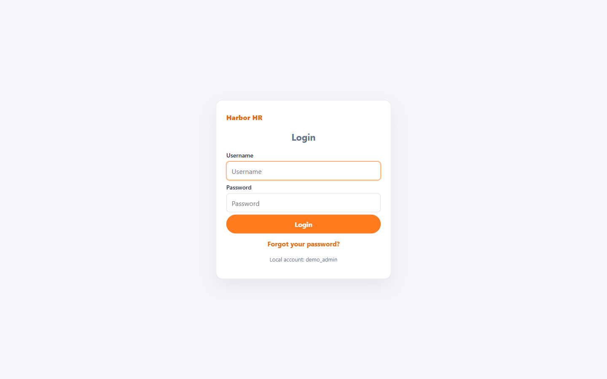
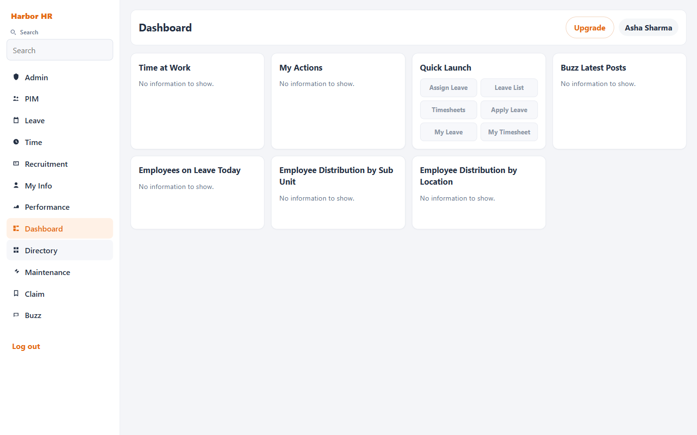
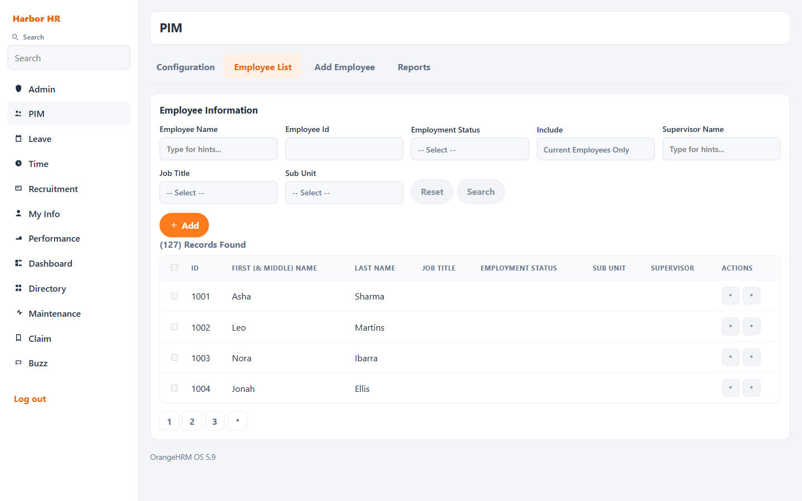

# Harbor HR

Independent internship project: a local human-resources application reconstructed from black-box observation of the public OrangeHRM demo.

Harbor HR is not OrangeHRM. It does not contain OrangeHRM source code, logos, or copied employee records, and the running application does not call `https://opensource-demo.orangehrmlive.com`.

The assignment is defined in the mentor guide *OrangeHRM Demo — Black-Box Reverse Engineering with REA* (5 November 2026). This repository records what was observed, what was built locally, how it was tested, and what remains incomplete.

**Readiness: conditionally ready for a local demonstration.** It is not a complete OrangeHRM clone.

## Internship context

The assigned work was to inspect only the observable user interface and network metadata of the public demo, keep a traceable evidence record, and build a small self-owned HRMS. Reverse Engineering Agent (REA) supplied browser evidence. The application itself was written separately in this repository.

No mentor name, employer name, or private communication is included here.

## Objective

From the guide:

> Inspect an existing web application's observable UI and behavior only and create a functionally similar, independently implemented mini HRMS application.

The suggested stack was React, TypeScript, FastAPI, PostgreSQL, and Playwright. That is the stack used here.

## Problem statement

A public demo can be watched, but watching it does not reveal the server source, the real database schema, or permission to automate the site. The problem was to separate three things:

1. Facts recorded from the demo.
2. Local design choices needed to make a usable application.
3. Behavior that was never opened, never clicked, or not authorized to capture.

Harbor HR implements the first group as observed labels and the second group as explicitly proposed local behavior. The third group stays disabled or undocumented as a completed workflow.

## Scope and boundaries

| In scope for the original definition of done | Outside that definition, or not completed |
|---|---|
| Local login and logout | Live demo login success, failure, and logout were not observed |
| Sidebar and a minimal dashboard | Search, Upgrade, punch times, and location chart values |
| PIM list, search, add, and local edit | Unopened profile sections and live row-action glyphs |
| Persistence in local PostgreSQL | Docker Compose was not demonstrated |
| Playwright on the local application | Playwright does not use PostgreSQL |
| Optional read-only Leave observation | Assign Leave and the other unclicked Leave actions |
| Admin landing, observe only | Admin user setup and settings are out of scope |

Destructive changes on the shared demo were not allowed. Automated scenario capture required a terms check first. That permission was not established.

## What REA is, and why it was used

REA (https://github.com/morluto/rea) captures and analyzes evidence from a running target. In this project it was used as a browser-observation tool: page structure, routes, control labels, and evidence identifiers. It was not used to decompile OrangeHRM or to recover a private API contract.

The guide's distinction holds: REA records evidence. The new application is separate code. Playwright and API tests check that local code.

### Setup that was actually verified

On 17 November 2026 the already installed package `rea-agents` 6.9.0 was checked with:

```text
rea doctor --client cursor --format json
```

`@latest` was not used, and no package was installed during that check. For the Cursor scope, `healthy` was true and the registration in the local Cursor MCP config was `aligned`. Doctor's `live_server.state` was `unknown`, so this README does not claim that a live REA browser session was open at the time of the check. The note is `docs/evidence/REQ-056-doctor-2026-11-17.md`.

Official references:

- https://github.com/morluto/rea
- https://github.com/morluto/rea/blob/main/docs/installation.md
- https://github.com/morluto/rea/blob/main/docs/browser-observation.md
- https://github.com/morluto/rea/blob/main/docs/browser-scenario-contract.md
- https://github.com/morluto/rea/blob/main/docs/website-script-export.md

## Methodology

The study was black-box.

1. Read the guide's limits: no copied source, no brute force, no bulk scraping, no writes on the shared demo.
2. Inspect pages that a normal signed-in session could open. The 15 November 2026 inspection used an existing Chrome session. Login was not submitted in that session.
3. Record the URL, headings, labels, table columns, and which buttons were not clicked.
4. Keep REA evidence identifiers (`ev_…`) and redacted JSON.
5. When a request was actually seen, record method, path, and status. Do not invent the body.
6. Build Harbor HR with synthetic people.
7. Leave a control disabled when it was visible and unused.
8. Mark a local save as proposed when the demo save was not clicked.

### Classifications

| Class | Meaning in this project |
|---|---|
| Observed | A recorded page fact or request |
| Derived | A count or summary the inspection itself recorded for that visit |
| Inferred | A reasonable relationship that was not watched end to end |
| Unknown | Not established |
| Proposed | A Harbor HR design with no evidence that the demo saved that way |
| Not verified | A required check that was not completed. REQ-055 is the register row with this status |

## Evidence

Original captures remain under `evidence/`. They are not the shareable set. Ten JSON files still contain an account display label. Sanitized copies, with that field set to null, are under `docs/proposed-redactions/`. Originals were not edited. The share boundary is `docs/PRIVACY_SHARING_MANIFEST.md`.

Examples of evidence identifiers, without account data:

| Screen | Evidence ID |
|---|---|
| Login | `ev_23bfc60faeae4f0c355e5c412e68490990ab6198db4734c3dae15b671783944c` |
| Dashboard | `ev_515f5cc06b8247a56227ff45a022914352805fce1f2809947f6aceef6bd6bc22` |
| Employee list | `ev_8e5ed00755e70c237bd5761ee055730f112992a1b6542880cf3103f6aecef493` |
| Leave list | `ev_4186ec732cc8193ff7bc90ebe234bbf9b70dc50cae17bf8cb265ab8efa54d400` |
| Apply Leave | `ev_6bba3523be55168510070545ba5ae2bdf2c34be3fac0ec67777de82f922c7521` |
| My Timesheet | `ev_b2964dacd0d97287223046488621ca652a325b2375b113426e34a6b85e2a273a` |
| System Users | `ev_bb35e6a6ab8a7eea8de2e0823b540583cd8f19b2523fdd3f4c5ae10677998d9b` |

The full module write-up is `docs/REA_REVERSE_ENGINEERING_REPORT.md`.

One observed OrangeHRM request, recorded as method, path, and status only, was `GET /web/index.php/api/v2/pim/employees` with status 200. That path is not implemented by Harbor HR. The Harbor contract is `docs/api-contracts.md`.

## Requirements and traceability

`docs/FINAL_REQUIREMENT_TRACEABILITY.md` is the 57-row register, REQ-001 through REQ-057. Statuses:

| Status | Count |
|---|---|
| PASS | 40 |
| PARTIAL | 13 |
| NOT VERIFIED | 1 |
| OUT OF SCOPE | 3 |

`docs/requirements.md` is a different 18-row list tagged OBSERVED or PROPOSED. It is not a second status total.

PARTIAL includes REQ-003. The open-source vulnerability policy prohibits security testing, scanning, and probing of the named demo. No document that was read permits automated browser capture. Silence was not treated as permission. **REQ-003 remains blocked for any new automated capture.**

NOT VERIFIED is REQ-055 only. A passive comparison returned `changed` and rejected a normalization key. There is no second sanitized scenario with the same step IDs. **REQ-055 remains unverified.** A new capture was not created.

OUT OF SCOPE: REQ-027 (Admin settings), REQ-044 (optional public login scenario), REQ-045 (optional frontend script analysis).

The shorter map from observation to local code is `docs/traceability-matrix.md`.

## Architecture

```text
Browser
  React + TypeScript, Vite on port 5173
        |
        |  cookie harbor_session
        v
FastAPI on port 8000
        |
        v
SQLAlchemy
        |
        +-- PostgreSQL database harbor   (development)
        +-- SQLite backend/harbor.db     (only if DATABASE_URL is unset)
        +-- SQLite backend/harbor-e2e.db (Playwright only)
```

`frontend/src/routes.ts` reads the pathname. Navigation uses the History API. Leave and Time also read the query string, for example `/leave?start=apply` and `/time?start=mine`. A visitor without a session sees only Login or the local forgot-password note.

Detail: `docs/architecture.md`.

## Technology stack

| Technology | Role | Why it is here |
|---|---|---|
| React and TypeScript | User interface | Named by the guide for the new application |
| Vite | Development server and production build | Local frontend tooling. Not part of the OrangeHRM observation |
| FastAPI | HTTP API | Named by the guide |
| SQLAlchemy | Table definitions and queries | Local persistence layer |
| PostgreSQL 16.2 | Development database `harbor` | Named by the guide. Started with `pgserver` on this machine, not Docker |
| PBKDF2-SHA256, 200000 iterations | Password hash | Local choice. OrangeHRM's hash was not observed |
| HttpOnly cookie `harbor_session` | Session | Local choice. `SameSite=Lax` |
| Playwright | Browser regression of Harbor HR | Named by the guide for the local replica |
| pytest | API tests | Local verification |

Docker Compose is `docker-compose.yml`. It reads `HARBOR_DB_PASSWORD` from the environment. Docker was not installed, so Compose was not started. That is REQ-051, PARTIAL.

## Authentication

`POST /api/auth/login` checks the username and password, then sets `harbor_session`. `POST /api/auth/logout` deletes the session. `GET /api/auth/me` returns the username and display name.

The local username is `demo_admin`. The password is the environment value `HARBOR_LOCAL_PASSWORD`. It is not stored in source. The seeded display name is Asha Sharma. Employee names in the seed are synthetic.

## Sidebar modules

The sidebar has 12 items, in the order observed on the demo. Login is a separate page, not a sidebar item. My Info is one of the 12.

| Module | Harbor HR status | Tested locally | What is not claimed |
|---|---|---|---|
| Login | Implemented | Yes. Valid login, invalid login, logout | Demo success and logout were not observed |
| Dashboard | Implemented for counts and Quick Launch | Yes | Search and Upgrade stay disabled. Punch times and location values were not decoded |
| PIM | Implemented list, search, add, edit, delete, reports | Yes | Create Login Details and file upload stay disabled. Sort and page size are proposed |
| Leave | Partial. Leave List can store a proposed request. Apply shows the observed empty state and does not save | Yes | Assign, Entitlements, Reports, and Configure stay disabled |
| Time | Partial. Stored timesheets are listed. My Timesheet shows the observed labels | Yes. The test checks that Edit and Submit stay disabled | View, Edit, Submit, approve, and reject are not offered |
| Attendance | Partial, inside Time. Labels only | Yes. View and Save stay disabled | No punch rows are stored |
| Project Info | Not implemented | No | The label was seen and the page was not opened. There is no supporting evidence |
| Punch In/Out | Not implemented | No | The menu item was seen and the page was not opened. There is no supporting evidence |
| Recruitment | Partial. Proposed candidates and vacancies | Yes, as local records | The Vacancies page was not opened on the demo |
| My Info | Partial. Four observed sections for the seeded employee | Yes | Six sections were not opened. Live Save was not clicked |
| Performance | Partial. Proposed reviews and trackers | Yes, as local records | Configure, evaluation, and approval were not observed |
| Directory | Partial. Name and job-title search | Yes | Location stays disabled. Card layout was not copied |
| Maintenance | Partial. Password check, no purge | Yes, including a rejected password | The purge form was not seen |
| Claim | Partial. Proposed claims | Yes, as local records | Payment and View Details were not opened |
| Buzz | Partial. Text posts | Yes | Share Photos and Share Video stay disabled |
| Admin | Disabled landing | The page opens and the actions stay disabled | User setup and settings were not inspected and are out of scope |

A rendered heading is not a completed workflow. Disabled controls use a title that says the OrangeHRM control was visible and was not used.

## API

These are Harbor HR routes. They are not OrangeHRM routes. The full contract is `docs/api-contracts.md`.

| Area | Routes |
|---|---|
| Health | `GET /api/health` |
| Auth | `POST /api/auth/login`, `POST /api/auth/logout`, `GET /api/auth/me` |
| Employees | `GET /api/employees`, hints, meta, one employee, `POST`, `PATCH`, `DELETE` |
| Reports | `GET /api/reports` |
| Timesheets | `GET`, `POST`, `PATCH`, `DELETE` under `/api/timesheets`. The Time page does not expose create, edit, or delete |
| Leave, candidates, reviews, claims | List, create, update, delete |
| Vacancies and trackers | List, create, update, delete |
| Contact and emergency contacts | Get and replace contact. List, create, and delete emergency contacts |
| Buzz | `GET`, `POST`, `DELETE` text posts |
| Maintenance | `POST /api/maintenance/confirm` returns confirmation and does not purge |

Employee delete returns 409 when a dependent timesheet, leave request, review, claim, or tracker exists. Timesheet periods are limited to 14 days and leave requests to 30 days. Those limits are Harbor HR rules, not observed OrangeHRM messages.

## Database

Models are in `backend/app/models.py`. SQL files are `backend/migrations/001_init.sql` through `004_workflows.sql`. Startup also calls SQLAlchemy `create_all`. Tables:

`users`, `sessions`, `reports`, `employees`, `timesheets`, `timesheet_days`, `leave_requests`, `candidates`, `performance_reviews`, `claims`, `employee_contacts`, `emergency_contacts`, `vacancies`, `performance_trackers`, `buzz_posts`.

`docs/data-model.md` states that this schema is proposed. It is not a recovered OrangeHRM schema.

The seed creates 55 synthetic employees, six report titles, and the local user. Do not set `HARBOR_RESET` against database `harbor`. That flag drops tables and is used only by Playwright on its own SQLite file.

### Verification on 17 November 2026

Before the later Playwright run, a read-only count of `harbor` returned **55 employees and 1 timesheet**. `GET /api/health` returned HTTP 200 and `postgresql+psycopg://postgres@127.0.0.1:5432/harbor`. Login as `demo_admin` returned the seeded display name. After Playwright, the API was started again without `HARBOR_RESET`, and health again reported database `harbor`.

The integration test `backend/tests/test_postgres_integration.py` uses a different database, `harbor_test`. It was not re-run on 17 November. The last recorded full backend pytest is 16 November 2026: **9 passed** in 33.07 seconds, including `harbor_test`.

## Tests

Playwright config: `playwright.config.ts`. It starts an API with `DATABASE_URL=sqlite:///./harbor-e2e.db` and `HARBOR_RESET=1`. It does not use PostgreSQL. Ports 8000 and 5173 must be free, because `reuseExistingServer` is false.

Latest run, 17 November 2026:

| Command | Result |
|---|---|
| `npx playwright test` | **11 passed, 0 failed**, 3.1 minutes, exit 0, SQLite |

An earlier run the same day also passed 11 tests in 2.8 minutes. The tests cover login, invalid login, logout, dashboard, sidebar, Quick Launch routes, employee list, search, empty results, reset, pagination, add, edit, validation, proposed delete, reports, the other module screens, and the rule that timesheet Edit and Submit stay disabled.

Do not describe either run as a PostgreSQL test.

```powershell
cd backend
python -m pytest tests/test_api.py -q
python -m pytest tests/test_postgres_integration.py -q
```

The second command drops and recreates only `harbor_test`.

## Privacy

- `.env` holds `HARBOR_LOCAL_PASSWORD` and `HARBOR_DB_PASSWORD`. It is ignored.
- Do not commit database files, `backend/pgdata/`, or original labeled evidence.
- Do not zip the whole folder. That archive would include ignored secrets.
- Safe local screenshots are the Harbor HR review images listed in `docs/PRIVACY_SHARING_MANIFEST.md`. `evidence/review-screenshots/harbor-login-1440.png` shows a password hint and is excluded.







These images are local Harbor HR screens from the reviewed screenshot set, not captures of the OrangeHRM demo.

## Known limitations

- Automated demo capture is not authorized.
- REQ-055 is not verified.
- Live login success, logout, and most demo searches were not observed.
- Project Info, Punch In/Out, and Admin user setup are not implemented, because the supporting screens were not observed or are out of scope.
- Several module saves are proposed local behavior.
- Docker Compose was not run.

## Installation

Requirements that were present on the development machine: Node.js 24.22.1, Python 3.12, and PostgreSQL 16.2 listening on `127.0.0.1:5432`. PostgreSQL was started with `pgserver` through `python backend/start_postgres.py`, not with Docker.

```powershell
cd C:\Users\Aayushi Agarwal\Downloads\orangehrm-rea-poc
python -m pip install -r backend\requirements.txt
copy .env.example .env
```

Edit `.env` and replace both placeholders. Then, with PostgreSQL already running, and **without** `HARBOR_RESET`:

```powershell
$env:PYTHONPATH = "backend"
$env:DATABASE_URL = "postgresql+psycopg://postgres@127.0.0.1:5432/harbor"
python -m uvicorn app.main:app --host 127.0.0.1 --port 8000
```

Second terminal:

```powershell
cd frontend
npm install
npm run dev
```

Open `http://127.0.0.1:5173` and sign in as `demo_admin` with the password you placed in `.env`.

Playwright, only when ports 8000 and 5173 are free:

```powershell
npx playwright test
```

## Folder structure

```text
frontend/                 React application
backend/app/              FastAPI application
backend/migrations/       SQL for the local schema
backend/tests/            API tests and the harbor_test integration test
tests/e2e/                Playwright
docs/                     Requirements, audits, and the handover
docs/proposed-redactions/ Sanitized evidence copies
evidence/                 Original captures. Not the shareable set
playwright.config.ts      Local SQLite browser tests
docker-compose.yml        Optional. Not demonstrated
.env.example              Placeholders only
```

Further reading:

- `docs/FINAL_HANDOVER.md`
- `docs/FINAL_PROJECT_AUDIT.md`
- `docs/SIR_REA_WORK_EXPLANATION.md`
- `docs/screen-inventory.md`
- `docs/navigation-map.md`
- `docs/workflow-specifications.md`
- `docs/assumptions.md`

`docs/FINAL_COMPLETION_REPORT.md` exists and is an earlier completion note. Where it disagrees with `docs/FINAL_PROJECT_AUDIT.md`, use the audit.

## Learning outcomes

The work practiced separating observation from design, keeping evidence identifiers next to implementation, refusing to treat a visible button as a completed workflow, and keeping secrets out of the application source. It also showed the limit of black-box study: a local replica can be tested thoroughly while the live site's terms and several screens remain unresolved.

## Future improvements

Only after an explicit permission to capture the demo, or without any new demo capture:

- Record Project Info and Punch In/Out before building them.
- Keep Admin user administration out of scope unless the assignment changes.
- Run Playwright against PostgreSQL only with an isolated database, never by resetting `harbor`.
- Demonstrate Docker Compose on a machine where Docker is installed.

## Acknowledgement

This project follows the mentor's OrangeHRM reverse-engineering guide and the public REA documentation linked above. OrangeHRM is the observed product. Harbor HR is independent work. No company or mentor name is invented here.

## Guide checklist

The 17 November 2026 audit of the guide's 11 deliverable lines is `docs/FINAL_PROJECT_AUDIT.md`: **6 complete, 5 partial, 0 not verified, 0 blocked as a whole line, 0 not applicable.** The partial lines are REA live-server identity, site authorization, fully sanitized original evidence, unobserved login and search workflows, and secrets still present in original evidence that must not be published.
